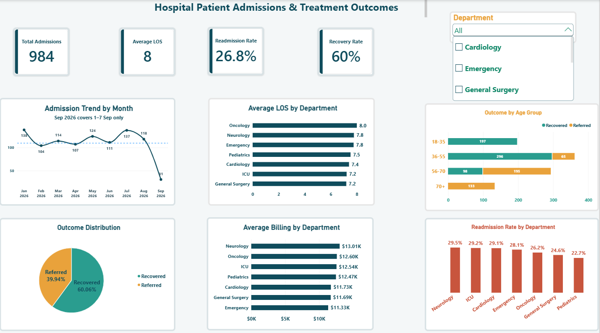

# Hospital Patient Admissions & Treatment Outcomes

**Capstone project · Speedlink Institute of Technology and Innovation · 2026**

**Tools:** Excel (data cleaning) · Power BI (Power Query, DAX, interactive dashboard) · PowerPoint (final defense)

**My role:** I completed this project independently from start to finish: I cleaned and prepared the data in Excel, wrote the DAX measures, built the 6-page Power BI dashboard, wrote the insights and recommendations, and prepared the final defense presentation.



---

## Business Problem
Hospital administrators needed a clear view of **patient flow**: how patients move from admission, through their stay, to their outcome and any readmission. The goal was a dashboard that supports bed and resource planning and highlights areas for further review.

## Dataset
- **Source:** Hospital admissions dataset provided for the Speedlink Institute capstone project
- **Size:** 984 patient records, 17 fields
- **Period:** 1 January – 7 September 2026
- **Key fields:** Department, Diagnosis, Procedure, Cost, Billing Amount, Length of Stay, Readmission, Outcome, Patient Satisfaction, Admission and Discharge Dates

## Data Cleaning
| Issue found | How it was fixed |
| --- | --- |
| Inconsistent department names ("Icu" vs "ICU") | Standardised to one label for each of the 7 departments |
| Billing stored as text ("$16,910.89") | Converted to numeric currency values |
| Dates stored as a mix of text and numbers | Converted to one consistent date format |
| 273 records (28%) with discharge dates before admission dates | Identified and resolved using the existing Length of Stay field; all 984 records now pass the date check |
| Possible extreme stays | IQR outlier test: stays range 1–14 days, 0 outliers |
| Fields needed for analysis | Added Age Group, LOS Outlier Flag and Date Logic Check columns |

## Key Measures (DAX)
```DAX
Total_Admissions  = COUNTROWS(PatientData)
Average_LOS       = AVERAGE(PatientData[Length of Stay])
Recovery_Rate     = DIVIDE(CALCULATE(COUNTROWS(PatientData), PatientData[Outcome] = "Recovered"), COUNTROWS(PatientData))
Readmission_Rate  = DIVIDE(CALCULATE(COUNTROWS(PatientData), PatientData[Readmission] = "Yes"), COUNTROWS(PatientData))
```

## Dashboard KPIs
| KPI | Result |
| --- | --- |
| Total admissions | 984 |
| Average length of stay | 7.6 days |
| Readmission rate | 26.8% |
| Recovery rate | 60.1% (591 recovered, 393 referred) |
| Length-of-stay outliers | 0 (IQR method) |

## Key Insights
1. **Age is the strongest pattern in outcomes.** All patients aged 18–35 recovered (197 of 197), while all patients aged 70+ were referred (133 of 133). Patients aged 56+ account for 328 of the 393 referrals (83%). This is an observed pattern, not proof that age causes the outcome.
2. **About 1 in 4 patients is readmitted.** Readmission ranges from 22.7% in Pediatrics to 29.5% in Neurology, with Neurology, ICU and Cardiology all above 29%.
3. **Stay length and billing are similar across departments.** Average stay is 7.2–8.0 days in every department. Average billing ranges only from $11,328 (Emergency) to $13,008 (Neurology).
4. **Admissions were steady.** Between 104 and 138 admissions a month from January to August. The apparent September drop reflects only 7 days of data.
5. **Recovered patients were more satisfied.** Average satisfaction was 3.8 out of 5 for recovered patients versus 3.2 for referred patients.

## Recommendations
1. **Plan bed capacity on a 7.6-day average stay** for all departments. Differences between departments are too small to justify separate buffers yet.
2. **Prepare referral and transfer pathways for patients aged 56+**, who make up 83% of referrals.
3. **Review discharge and follow-up in Neurology and ICU**, which combine readmission near 29% with above-average billing.
4. **Add validation at data entry** so a discharge date cannot be earlier than the admission date.
5. **Collect at least 12 months of data** to confirm seasonal trends and the age-outcome pattern.

## Files in this Repository
- `Hospital_Admissions_Data.xlsx` – cleaned dataset with KPI summary sheet
- `Hospital_Admissions_Dashboard.pbix` – Power BI dashboard (6 pages)
- `Hospital_Admissions_Presentation.pptx` – final defense slides
- `dashboard.png` – dashboard screenshot
